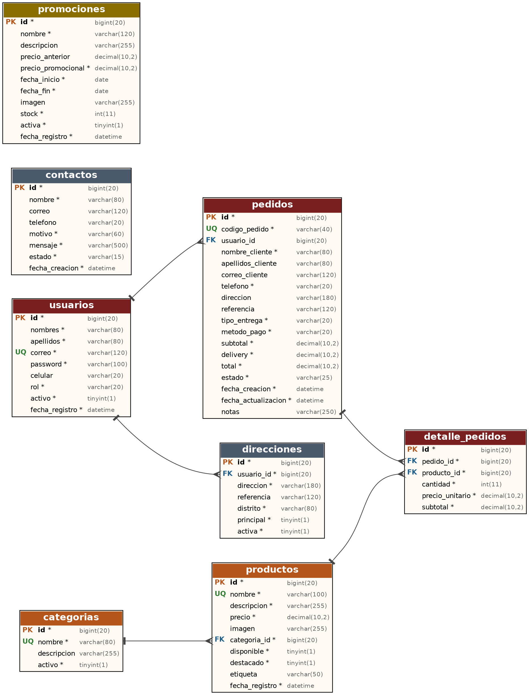

# 🍗 Pollos Los Campos — Aplicación web con Spring Boot y Thymeleaf

Proyecto del curso **Marcos de Desarrollo Web** (Ingeniería de Sistemas, ciclo VI, 2026).
Aplicación web dinámica para una pollería: catálogo, promociones, pedidos en línea con seguimiento,
cuentas con roles y panel de administración.

## Tecnologías
Java 21 · Spring Boot 4.1.1 · Spring Web MVC · Thymeleaf · Spring Data JPA · H2 (por defecto) / MySQL (opcional) ·
Spring Security + BCrypt · Bean Validation · Maven · JUnit 5 · HTML5 / CSS3 / JavaScript.

## Arquitectura
`Controller → Service → Repository → Base de datos` con `entity` (modelo), `dto` (formularios validados),
`config` (seguridad y datos iniciales) y `exception` (manejo global de errores).

```
src/main/java/com/pollosloscampos/
├── controller/   Web, Auth, Contacto, Pedido, Admin, Api (REST)
├── service/      Producto, Categoria, Promocion, Pedido, Usuario, Contacto, Reporte
├── repository/   8 repositorios Spring Data JPA
├── entity/       Usuario, Producto, Categoria, Promocion, Pedido, DetallePedido, Direccion, Contacto + enums
├── dto/          Formularios con validaciones
├── config/       SecurityConfig, DataInitializer
└── exception/    GlobalExceptionHandler
src/main/resources/ templates/ (Thymeleaf, admin/, error/) · static/ (css, js, images) · application*.properties
database/           scripts SQL, backup y documentación de la BD
docs/               modelo entidad-relación y capturas de pantalla
```

## Base de datos
Ver [`database/README-BD.md`](database/README-BD.md): 8 tablas, PK, FK, UNIQUE, 20 CHECK, índices,
3 vistas, 3 triggers, 1 función y 5 procedimientos almacenados. Backup en `database/backup/`.



## Ejecución
Consulte [`COMO_EJECUTAR.txt`](COMO_EJECUTAR.txt). Resumen: JDK 21 + MySQL → ejecutar los scripts de `database/` → `./mvnw spring-boot:run` → http://localhost:8080
(Sin MySQL: `./mvnw spring-boot:run -Dspring-boot.run.profiles=h2`)

| Rol | Usuario | Contraseña |
|---|---|---|
| Administrador | admin@pollosloscampos.local | Admin123! |

## Rutas
Públicas: `/`, `/menu`, `/producto/{id}`, `/promociones`, `/nosotros`, `/contacto`, `/pedido`, `/seguimiento`, `/login`, `/registro`.
Privadas: `/cuenta` (autenticado) y `/admin/**` (`ROLE_ADMIN`).

## API REST
`GET /api/productos`, `GET /api/productos/{id}`, `GET /api/categorias`, `GET /api/promociones`, `POST /api/pedidos`,
`GET /api/pedidos/{id}`, y (ADMIN) `POST/PUT/DELETE /api/productos`, `PUT /api/pedidos/{id}/estado`, `GET /api/dashboard/resumen`.

## Pruebas
`./mvnw clean test` — PedidoServiceTest (5), UsuarioServiceTest (2) y carga del contexto (1).

## Integrantes
Vásquez Sánchez Edgardo José · Diaz Cumpa Leonardo Fabrisio · Ramírez Flores Carlos Aldair · Colchado Urbina Oliver Stalin · Lucero Suclupe Esteban
Docente: Juliana del Pilar Alva Zapata
